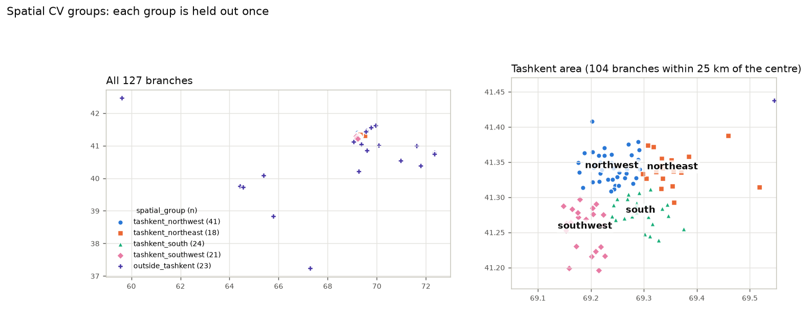
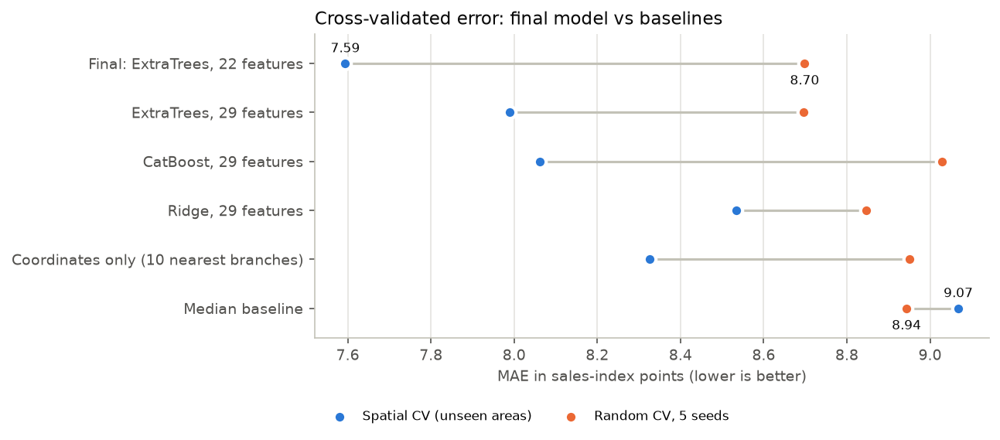
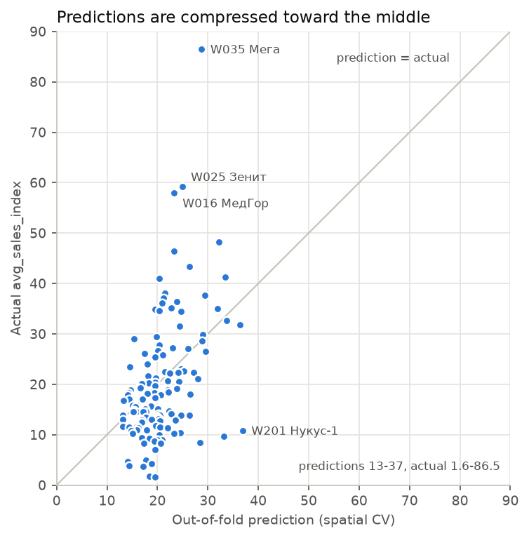
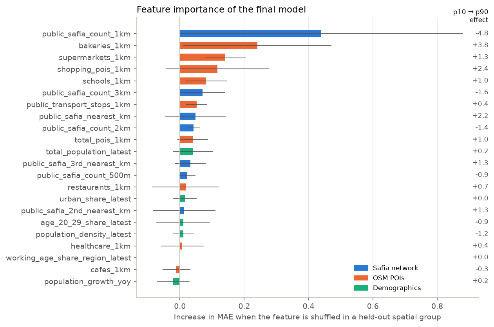

# Predicting the sales potential of a new Safia branch from its location

Final report, 13 October 2026. Code, data and instructions: [README.md](../README.md).

**Summary.**

- **What was built:** a model that turns a proposed site's latitude and longitude into an expected sales
  index. It uses only information available before opening: official Safia store locations, OpenStreetMap
  context and stat.uz district statistics. It runs offline.
- **Final model:** ExtraTrees on 22 features: 9 POI counts within 1 km, 7 Safia-network features and
  6 district demographics.
- **Accuracy at unseen areas:** in geography-aware cross-validation the model's mean absolute error is
  **7.59** index points, against **9.07** for predicting the median. The improvement over branches is
  1.40 (95% CI 0.40–2.33).
- **Accuracy at familiar areas:** in random cross-validation the improvement is small (0.53, CI −0.42 to 1.45).
- **How strong the signal is:** modest. Predictions are compressed toward the middle of the range, so the
  model is useful for separating weak, average and promising sites rather than for spotting exceptional
  top sellers.
- **What predicts better sales:** fewer other Safia stores nearby and denser commercial and food-retail
  surroundings. These are predictive associations, not causal effects.

## 1. Problem

Safia wants to estimate the expected sales of a proposed branch before opening it. The system takes a
location (latitude, longitude), derives the same location features that were computed for the existing
branches, and returns an expected sales index on the supplied 1–100 scale. Two requirements shaped the
work:

- Only pre-opening information may enter the model.
- The model must be judged by how well it predicts at locations it has not seen.

## 2. Data and target

**Supplied data.** 127 branches (125 Safia, 2 Safia Mini) with coordinates and daily sales and orders
indices for 1–10 September 2026: 1,270 branch-days from an iiko export. The supplier excluded stores with
partial or no sales, without a location, with a wrong location, or that are not stores.

**Target.** `avg_sales_index` is a branch's mean daily sales index over the ten days. The daily index is
the branch's sales after discounts divided by the highest single-day sales of any included branch, times
100. The scale is relative: 100 occurs once, for one branch-day, so branch averages span 1.61–86.51
(median 17.84, mean 20.36, skewness 1.86). Мега (86.5) is a lone outlier, 27 points above the next branch.

The exploratory analysis ([01_eda_report.md](01_eda_report.md)) accepted the mean as the target:
- Branch rankings are stable from day to day (Spearman 0.90–0.97 between any two days).
- The mean and the median of the daily values agree (r = 0.998).
- The index is mainly a volume measure (r = 0.93 with orders).

With ten days, including one weekend and one public holiday, the target measures early-September 2026
performance of established branches.

**Geography.** 101 branches are in Tashkent city and 26 elsewhere, spread over about 20 towns and their
surroundings, mostly one branch each. The variation the model has to explain is mainly inside Tashkent.

## 3. Data-quality investigation

**Branch coordinates.** Every supplied coordinate was compared with Safia's official store list
(safiabakery.uz, snapshot of 11 October 2026), matching on names (exact, old name in brackets, whole-word
subset; never fuzzy). Distances only flagged cases for review. Eleven coordinates were wrong and were
corrected through `data/processed/branch_coordinate_overrides.csv`, with the reason and source of each.
The supplied file is never edited. Each correction was cross-checked against OpenStreetMap (street,
address or a mapped Safia shop at the official point).

| problem | branches | size of the correction |
|---|---|---|
| point copied from another branch (0.2–11 m from that branch's point) | W075, W215, W046, W161, W023 | 4.7–14.5 km |
| wrong city | W074 «Фергана» (supplied in Tashkent), W174 «БУХ Вокзал» (Kagan station) | 228 km, 12 km |
| wrong spot in the right city | W018, W002, W003, W015 | 0.9–7.4 km |

121 branches now match an official store. Six are kept as supplied and documented in
`branch_coordinate_qa.csv`:
- W081 and W093 are close to two candidate stores (555 m and 698 m apart).
- W219 needs review.
- W158 and W211 are not on the official list.
- W061 «Нукус» has the largest residual risk: its point is on the official «Турин» store, while the store
  on Nukus street («Глинка») is 8.4 km away. Only Safia can confirm it.

**Official store list.** It contains 173 stores, 13 of them in Kazakhstan (Almaty, Shymkent); the
remaining 160 form the network used for features. Three labelled branches are missing from it.

**District boundaries.** The common humanitarian boundary datasets (OCHA, geoBoundaries) are shifted
about 4 km in Tashkent, so OpenStreetMap boundaries were used instead. Branches are matched to stat.uz
units by point-in-polygon. One branch (W187, Termez) lies in an OSM district that also contains the city,
and was assigned to the city by hand.

**OpenStreetMap completeness.** Mapping density varies by city. Central Nukus is mapped shop by shop: its
branch has 1,046 POIs within 1 km, against a Tashkent median of 185. Counts were kept raw rather than
normalised by city, and the effect is reported as a limitation.

**Semantic QA of the POI categories.** A late audit of `universities_2km` found that it counted OSM
objects tagged `amenity=university` or `amenity=college`, not institutions:
- At central Tashkent it counted 21 objects for about 15 real higher-education institutions. Three were
  duplicates and three were not universities (Goethe Institut, a Confucius Institute, a medical lyceum).
- Country-wide only 18% of the 1,328 objects are named higher-education institutions. About 52% are
  vocational colleges, lyceums or schools, 20% are unnamed, and 6% are faculties or buildings.

The feature was removed and not replaced. The other categories that drive the model (bakeries,
supermarkets, shops) have at most 0.6% duplicates.

## 4. Feature engineering

All features are computed from the coordinates with functions in `src/sofia_task/`. The predictor uses
the same functions for a new site. Feature files store raw values; `log1p` of counts and distances is a
step inside the model pipeline.

| family | candidates | in the final model | content |
|---|---|---|---|
| Demographics (stat.uz, district level) | 6 | 6 | population density, total population, growth 2025→2026, urban share, working-age share (region level), share aged 20–29 |
| Official Safia network | 7 | 7 | distance to the 1st, 2nd and 3rd nearest official store; stores within 0.5, 1, 2, 3 km |
| 127-branch network (alternative) | 7 | 0 | the same, against the labelled branches only; robustness check |
| OSM points of interest | 16 | 9 | bakeries and confectioneries, cafés, restaurants, supermarkets, convenience stores, all shops, schools, healthcare, transport stops, all POIs; within 500 m and/or 1 km |
| Accessibility (OSM roads) | 7 | 0 | distance to a major road, road density, major-road length, intersections (500 m and 1 km) |

A branch's own official store is left out of its network features, so a training row describes the
*other* stores around it, exactly as for a new site. Excluded as leakage: orders, average check, daily
values, ranks and anything else derived from performance. Store format was excluded because there are only
two Safia Mini branches (both weak, mean 4.4).

## 5. Validation design

The unit of validation is a branch; branch-days are never separate rows. The folds were fixed in
`data/processed/cv_folds.csv` before any model was compared.

- **Random CV:** 5-fold, shuffled with seed 42 (folds of 25–26). It was later repeated with five seeds
  because a single split of 127 branches proved noisy.
- **Spatial CV (primary):** k-means on all 127 points never splits Tashkent: the far regional branches take
  the clusters, and the whole Tashkent area stays one cluster of 105–113 branches until k = 15. Instead,
  the 104 branches within 25 km of central Tashkent are split into four k-means sectors (northwest 41,
  south 24, southwest 21, northeast 18), and the 23 branches farther out form a fifth group. Each group is
  held out once, so the model is always scored on an area it has not seen.

**Metrics.** MAE (primary, in index points), RMSE and Spearman rank correlation, computed per held-out fold
and reported as mean ± standard deviation over the folds.

**Baselines.**

| baseline | spatial MAE | random MAE (seed 42) | random MAE (5 seeds) |
|---|---|---|---|
| median of the training folds | 9.07 ± 2.54 | 8.84 ± 2.35 | 8.94 |
| mean of the training folds | 9.07 ± 1.86 | 9.28 ± 1.98 | – |
| coordinates only (mean of the 10 nearest branches) | 8.33 ± 2.75 | 8.47 ± 1.84 | 8.95 |

## 6. Experiments and ablations

All numbers below come from `reports/model_results.csv`, the final rerun after `universities_2km` was
removed. Selection decisions were made on the same experiments run on 12 October, with that feature still in the
POI family; each decision is confirmed by the rerun, and none was revisited.

**Feature families.** Same models, same folds, only the feature set changes (MAE):

| feature set | n | Ridge, spatial | ExtraTrees, spatial | Ridge, random | ExtraTrees, random |
|---|---|---|---|---|---|
| demographics | 6 | 8.59 | 8.87 | 9.26 | 9.11 |
| POIs | 16 | 9.00 | 9.14 | 9.08 | 9.01 |
| official network | 7 | 8.87 | 8.86 | 9.23 | 9.38 |
| 127-branch network | 7 | 8.97 | 9.07 | 9.28 | 9.12 |
| accessibility | 7 | 9.20 | 9.48 | 9.38 | 9.55 |
| POIs + network | 23 | 8.53 | 8.00 | 8.75 | 8.31 |
| POIs + demographics | 22 | 8.72 | 8.72 | 9.06 | 8.75 |
| **POIs + network + demographics** | 29 | 8.53 | **7.99** | 8.68 | 8.33 |
| same with the 127-branch network | 29 | 8.48 | 8.23 | 8.81 | 8.24 |
| all four families | 36 | 8.85 | 8.15 | 8.87 | 8.56 |
| all minus demographics | 30 | 8.84 | 8.22 | 8.89 | 8.51 |
| all minus POIs | 20 | 9.96 | 8.81 | 9.18 | 9.04 |
| all minus network | 29 | 8.99 | 8.92 | 9.11 | 8.97 |
| *median baseline* | – | 9.07 | 9.07 | 8.84 | 8.84 |

- **POIs and network work only together.** No family alone beats the baseline by much. POIs and network
  together reach 8.00 with ExtraTrees, and removing either from the full set costs about 0.7.
- **Demographics add almost nothing** (8.00 → 7.99).
- **Accessibility has no signal on its own and hurts when added** (7.99 → 8.15), so it was dropped.
- **The two network definitions are equivalent within noise.** The official list was kept because a new
  site is scored against the full network.

**Model comparison** (POIs + network + demographics, 29 features):

| model | spatial MAE | spatial RMSE | spatial Spearman | random MAE (seed 42) | random MAE (5 seeds) |
|---|---|---|---|---|---|
| Ridge | 8.53 ± 2.69 | 11.26 | 0.39 | 8.68 | 8.85 |
| Ridge, log target | 8.72 ± 2.93 | 12.17 | 0.38 | 8.41 | 8.58 |
| **ExtraTrees** | **7.99 ± 1.67** | 10.57 | 0.35 | 8.33 | 8.70 |
| ExtraTrees, log target | 7.95 ± 1.97 | 10.70 | 0.33 | 8.29 | 8.61 |
| CatBoost | 8.06 ± 1.72 | 10.74 | 0.29 | 9.03 | 9.03 |
| CatBoost, log target | 8.33 ± 1.35 | 10.97 | 0.23 | 8.87 | 8.91 |

ExtraTrees (500 trees, minimum leaf size 3, max_features 0.5, set once by hand) was chosen over CatBoost:
- **Spatial CV:** in the selection run CatBoost had a small spatial advantage (7.76 vs 7.93). That gap is
  well inside the fold noise (standard deviation about 1.7), and in the final rerun ExtraTrees is ahead
  (7.99 vs 8.06).
- **Random CV:** CatBoost was inconsistent, no better than the median baseline (9.03 over five seeds,
  against 8.94).
- **Log target:** it ties on MAE and is worse on RMSE, so the raw target was kept.
- **Settings:** a one-off sensitivity check during selection (minimum leaf 3–5, max_features 0.33–0.5)
  gave 7.8–7.9 spatial MAE, so no tuning was needed.

**Final check: 1 km context instead of 500 m.** The 500 m POI counts had negative held-out permutation
importance, so one comparison was run with the same model, folds and settings. Without the seven 500 m
counts, spatial MAE improves from 7.99 to **7.59**, and random CV is unchanged (8.70 over five seeds). In
the selection run every held-out area improved. This was the last selection step.

**Robustness checks** (ExtraTrees):

| check | result |
|---|---|
| official vs 127-branch network | 7.99 vs 8.23 spatial, 8.33 vs 8.24 random: equivalent |
| without the aggregate `total_pois_*` counts | 7.85 vs 7.99 spatial: no dependence on them |
| median of the daily index as target | 8.00 vs 9.04 for the median baseline: same picture |
| random CV over five seeds | the seed-42 split is optimistic (8.33 vs 8.70 over seeds) |
| `universities_2km` removed | final-model spatial MAE 7.64 (selection run) → 7.59 (rerun) |

## 7. Final model

- **Model:** `ExtraTreesRegressor(n_estimators=500, min_samples_leaf=3, max_features=0.5, random_state=0)`,
  with `log1p` on the 16 count and distance features and the raw target, trained on all 127 branches.
- **Saved files:** `models/final_model.joblib` holds the full pipeline. `models/model_metadata.json`
  records the feature order, preprocessing, metrics, exclusions and data-snapshot dates.

**Predictor.** `sofia_task.predict.predict_location(lat, lon)` works in five steps:
1. Finds the stat.uz district by point-in-polygon. It raises a clear error outside Uzbekistan, and asks
   for a choice in the four districts that OSM does not split from their city.
2. Computes the POI counts and the official-network features. For a new site, all 160 official stores
   count.
3. Builds the 22 features in metadata order.
4. Predicts, clipping only to 1–100. That clip never binds, because a tree average stays within the
   training range.
5. Returns the expected sales index and the relative location potential: the prediction's percentile
   among the 127 out-of-fold predictions. The potential is a ranking, not a second forecast.

It runs offline in about 1 s, plus about 20 ms per location. Runtime features reproduce the stored
training features of all 127 branches exactly (2,794 values), and the 17 tests cover:
- feature reproduction and schema;
- offline operation (network blocked);
- determinism and error handling;
- the percentile layer;
- the UI.

## 8. Results

| validation | MAE | RMSE | Spearman | median-baseline MAE |
|---|---|---|---|---|
| **spatial CV** | **7.59 ± 1.66** | 10.20 | 0.34 | 9.07 |
| random CV (seed 42) | 8.31 ± 1.59 | 11.52 | 0.43 | 8.84 |
| random CV, 5 seeds | 8.70 ± 1.57 | 12.03 | 0.32 | 8.94 |

**Gain over the baseline.** Pooled over branches, out-of-fold MAE falls from 9.29 to 7.89 in spatial CV, a
gain of 1.40 (95% bootstrap CI 0.40–2.33). In random CV it falls from 8.84 to 8.31, a gain of 0.53 (CI
−0.42 to 1.45).

The gain is larger where whole areas are held out because area-level differences in sales are partly
explained by the features. The constant baseline cannot follow them, and loses more when an area with a
different level is removed from training.

**By held-out area** (spatial MAE):

| area | branches | final model | median baseline |
|---|---|---|---|
| outside Tashkent | 23 | 8.01 | 10.81 |
| Tashkent northeast | 18 | 8.35 | 10.59 |
| Tashkent northwest | 41 | 9.74 | 10.63 |
| Tashkent south | 24 | 6.20 | 8.44 |
| Tashkent southwest | 21 | 5.66 | 4.86 |

The model beats the baseline in four of the five areas. It is worse only in the southwest, where branches
are uniformly modest and the baseline already does well.

**What the predictions can and cannot do.** Out-of-fold predictions span only 13–37, while actual values
span 1.6–86.5.

Ranking works reasonably well:

| predicted third | branches | median actual index |
|---|---|---|
| bottom | 43 | 14.6 |
| middle | 42 | 16.5 |
| top | 42 | 24.8 |

Exceptional branches are under-predicted: the top tenth of branches by actual sales (≥ 35.5) is predicted
25.3 on average. The largest misses are flagship-type stores (Мега 86.5 → 28.8, Зенит 59.2 → 24.9,
МедГор 58.0 → 23.2) and the OSM-dense Nukus branch (10.9 → 36.9).

## 9. Interpretation

Held-out permutation importance: the increase in MAE when one feature is shuffled in a held-out spatial
group, averaged over the five groups. Direction comes from the change in the average prediction when the
feature moves from its 10th to its 90th percentile.

| feature | family | importance (± std over groups) | 10th → 90th percentile | effect |
|---|---|---|---|---|
| other official Safia stores within 1 km | network | 0.44 ± 0.44 | 0 → 2 | −4.8 |
| bakeries and confectioneries within 1 km | POIs | 0.24 ± 0.23 | 0 → 8 | +3.8 |
| supermarkets within 1 km | POIs | 0.14 ± 0.06 | 2 → 9 | +1.3 |
| all shops within 1 km | POIs | 0.12 ± 0.16 | 23 → 146 | +2.4 |
| schools within 1 km | POIs | 0.08 ± 0.07 | 3 → 10 | +1.0 |
| official Safia stores within 3 km | network | 0.07 ± 0.07 | 0 → 18 | −1.6 |
| transport stops within 1 km | POIs | 0.05 ± 0.03 | 7 → 54 | +0.4 |
| distance to the nearest official store | network | 0.05 ± 0.09 | 0.5 → 11 km | +2.2 |

Summed by family, POIs (0.68) and the network (0.67) carry almost all of the model's held-out signal, and
demographics very little (0.05).

**Raw data, consistent with the model.**
- **Safia saturation:** branches with no other official store within 1 km have a median index of 20.9
  (68 branches), against 14.5 for one or two stores (51). Inside Tashkent alone the medians are 20.5 and
  14.5. The eight branches with three or more such stores have a median of 17.4, too few to read a trend.
- **Bakeries:** in Tashkent, branches with no bakery or confectionery within 1 km have a median of 13.2,
  rising to 20.3 with six or more.

**Reading these cautiously.** These are predictive associations across 127 existing branches, not causal
effects.
- The saturation pattern fits cannibalisation, but it can also reflect where Safia has historically placed
  stores, for example dense older districts.
- Commercial density is probably a proxy for footfall rather than a driver in itself.
- Correlated features share importance, and the spread across held-out areas is large: the top feature
  measures 0.44 ± 0.44.

## 10. Limitations

- **Small sample.** 127 branches, about 101 of them in Tashkent city. Regional towns are represented
  mostly by one branch each.
- **Short target window.** Ten days, with one weekend and one public holiday. Seasonality and trend cannot
  be assessed.
- **Uneven OpenStreetMap completeness.** Central Nukus is far more densely mapped than Tashkent, and its
  branch is over-predicted by 26 points.
- **Compressed predictions.** Out-of-fold predictions span 13–37 against actual values of 1.6–86.5. The
  model separates weak, average and promising sites better than it identifies exceptional top sellers.
- **Missing store-level drivers.** Mall location, floor area and opening date are not in the data. They
  probably explain much of the remaining error, especially for flagship stores.
- **Format not modelled.** Safia Mini has only two examples.
- **Model-selection uncertainty.** About 40 configurations were compared on the same folds, so the
  cross-validation estimates are slightly optimistic.
- **One spatial partition.** The spatial CV uses a single partition of the map, and the fold-level spread
  is large (± 1.7 MAE).
- **Residual data risks.** One coordinate (W061) remains uncertain, and three labelled branches are missing
  from the official list.

## 11. Conclusion

A reproducible, offline system turns a latitude and longitude into an expected sales index and a relative
location potential. It uses only pre-opening information.

In the validation that matches the business question, prediction at unseen areas, it reduces the error of a
median guess from 9.07 to 7.59 index points. The usable signal comes from the official Safia network
around the site and the commercial and food-retail density within 1 km, and works only when the two are
combined.

The signal is real but modest. The model is suited to screening and ranking candidate sites, flagging
likely weak, average or promising locations, rather than to forecasting the sales of an individual store.

The most valuable next steps are:
- more labelled branches and a longer sales window;
- store-level attributes such as mall, size and opening date;
- footfall data;
- city-aware handling of OpenStreetMap completeness.

**Artifacts.**

| file | content |
|---|---|
| `reports/model_results.csv`, `model_results_by_fold.csv` | all experiments |
| `reports/feature_importance.csv` | final-model importance |
| `reports/final_model_oof.csv` | out-of-fold predictions; the percentile reference |
| `reports/figures/` | the four figures above |
| `models/model_metadata.json` | features, metrics and data snapshots |
| `data/processed/cv_folds.csv` | the frozen folds |
| `reports/01_eda_report.md` | target analysis |
